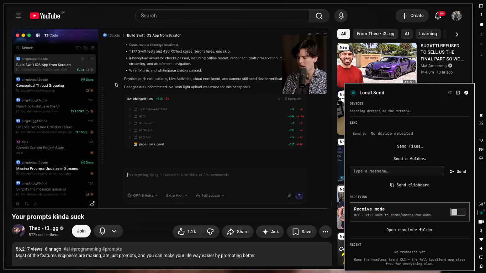

# omarchy-localsend

A LocalSend mini-app for the Omarchy bar (Quickshell). One button, one menu: pick a nearby device, send files, folders, keystrokes-free clipboard and text messages, toggle receive mode, all without leaving the bar.



## What it does

- **Bar button** — the LocalSend logo, with a status dot: accent while receiving or when a transfer is in flight, dim otherwise. Left-click opens the menu; right-click opens the full LocalSend GUI app.
- **Device discovery** — automatic on menu open (UDP multicast via `lsend scan --json`), again refreshable; rows show alias + IP. Your last chosen device is remembered and re-selected when it reappears.
- **Send** — files (multi-select), whole folders, clipboard text, or a typed message (Enter to send), to the selected device. Queued sends, per-transfer success/failure verdicts, desktop notifications via `omarchy-notification-send`.
- **Receive mode** — toggle inside the menu starts a systemd-user receiver (`lsend receive --json --dir <saveDir>`), auto-accepting into your configured folder (default `~/Downloads`), optional numeric PIN (PIN mode, as in the app). Incoming transfers are watched via `journalctl --user -f` on the unit and fire notifications + history entries. Handles the GUI-app port conflict (pings you, hands off port 53317).
- **Recent transfers** — the last few sends/receives with direction, peer, relative time, failure tint; persisted to `~/.local/state/localsend-menu/history.json`.
- **Full app shortcut** — footer row opens/focuses the real LocalSend app for anything else (pairing, trust, reluctant settings).

## Install

### Dependencies

```bash
# the headless LocalSend CLI (protocol v2, official-compatible)
curl -fsSL https://github.com/lsendapp/lsend-cli/releases/latest/download/lsend-x86_64-unknown-linux-musl.tar.gz \
  | tar xz && install -m 755 lsend ~/.local/bin/lsend

# the GUI app itself (for the full-app shortcut) — pacman or your favorite
omarchy pkg add localsend
```

### Plugin

```bash
omarchy plugin add https://github.com/ansonboby/omarchy-localsend --enable --yes
```

Or drop the dir into `~/.config/omarchy/plugins/anson.localsend/` and add `{ "id": "anson.localsend" }` to `shell.json`'s bar layout.

### Receiver unit (optional, for receive mode)

```bash
cp omarchy-localsend-receiver.service ~/.config/systemd/user/
systemctl --user daemon-reload
```

The panel manages start/stop itself; the unit just needs to exist.

## Settings (shell.json inline, or the widget settings UI)

| Key | Default | Meaning |
|---|---|---|
| `saveDir` | `~/Downloads` | where received files land |
| `requirePin` | false | senders must quote the PIN |
| `pin` | — | numeric PIN, only with `requirePin` |
| `scanTimeoutMs` | 6000 | device scan window |
| `iconImage` | stock logo | bar button image (empty → glyph) |
| `iconGlyph` | — | nerd-font glyph fallback |
| `historyLimit` | 50 | transfer history cap |
| `historyLimit` | 50 | transfer history cap |

## One port, two owners

The headless receiver daemon and the GUI app both bind UDP/TCP 53317 — they
trade the port, they never share it:

- **Receive on** while the GUI app runs → the plugin closes the app (with a
  notification) and starts the daemon.
- **Open full app** (footer row, right-click the bar icon, or `o` in the
  menu) while receiving → the plugin stops the daemon first (with a
  notification), so the app never sees OS error 98 ("address already in
  use") and starts online.

The switch tells you this in place: "opening the GUI app pauses this".

## IPC / keybinding

```
quickshell ipc -p /usr/share/omarchy/shell call anson.localsend receiveOn
quickshell ipc -p /usr/share/omarchy/shell call anson.localsend receiveOff
quickshell ipc -p /usr/share/omarchy/shell call anson.localsend openApp
quickshell ipc -p /usr/share/omarchy/shell call anson.localsend open|toggle
```

Bind them to keys in your Hyprland config if the mode deserves a hotkey.

## Notes

- Protocol: LocalSend v2, spoken by `lsend` (lsendapp/lsend-cli). Official app can send to this receiver and this can send to the official app on other devices.
- PIN discipline: `lsend` persists a required PIN to `~/.config/lsend/receive_pin` and its lookup order is --pin > that file > env. The receiver wrapper clears that file whenever the plugin has PIN off, so a PIN once tested never silently sticks; when PIN is on, both are kept in sync on every (re)start.
- Local-first: everything stays inside your plugin dir + `~/.local/state/localsend-menu/`.

## Credits

- Built on the [Omarchy shell](https://omarchy.org) plugin/Ui kit (`qs.Ui` panels, `Quickshell.Io`)
- [lsendapp/lsend-cli](https://github.com/lsendapp/lsend-cli) for the headless protocol v2 client
- [LocalSend](https://localsend.org) — the app this wraps
